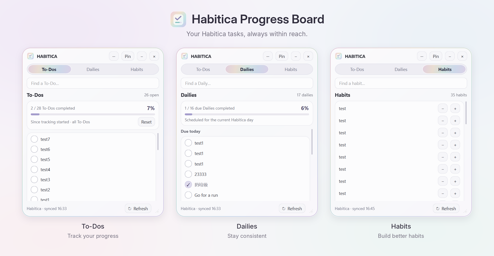

<p align="center">
  
</p>

<h1 align="center">Habitica Progress Board</h1>

<p align="center"><strong>Your Habitica tasks, always within reach.</strong></p>
<p align="center">A compact Windows desktop widget for To-Dos, Dailies, and Habits.</p>

<p align="center">
  
  
  
  
</p>

<p align="center">
  
</p>

Habitica Progress Board is an independent desktop companion for [Habitica](https://habitica.com/). It keeps your tasks visible while you work, so you can check off a To-Do, complete a Daily, or score a Habit without switching to your browser.

The widget combines a soft interface with compact task lists, progress tracking, and immediate local feedback while changes synchronize in the background.

## Features

- **To-Dos:** Track overall completion, check off tasks, and expand checklists with individual progress bars.
- **Dailies:** View recurring tasks, complete or undo them, and see progress for the current Habitica day.
- **Habits:** Score repeatable habits using their available `+` and `−` buttons.
- **Instant feedback:** Task changes are reflected locally before server confirmation, with a background action queue and reconciliation on failure.
- **Habitica synchronization:** Automatic refresh, manual refresh, and rate-limit cooldown handling using the official API.
- **Desktop widget:** Resizable, movable, optionally always on top, with compact mode and adjustable background opacity.
- **Large task lists:** Viewport-based rendering, smooth wheel scrolling, and debounced search.
- **Local preferences:** Remembers window settings and tracking history; optional Windows-encrypted token storage.

## Getting started

For Windows installers and portable builds, see [Releases](https://github.com/rey-Lii/habitica-progress-board/releases). If no binary is available yet, use the source installation below.

### Requirements

- Windows 10 or 11 (target platform)
- Python 3.10 or later
- PySide6-Essentials (Qt 6)
- A Habitica account for live synchronization

### Install and run

1. Select **Code → Download ZIP** on GitHub, or clone the repository.
2. Extract the entire ZIP into a regular folder. Keep the Python files together.
3. Open PowerShell in the extracted folder and install the dependency:

   ```powershell
   py -m pip install -r requirements.txt
   ```

4. Double-click `Launch.pyw` or run:

   ```powershell
   py .\Launch.pyw
   ```

If the widget does not open, use the PowerShell command above to diagnose startup errors. Make sure the same Python installation is used for installation and launch. `LaunchClassic.pyw` provides a compatibility mode for the task list.

### Try the demo

```powershell
py .\Launch.pyw --demo
```

The demo starts with sample tasks and does not automatically connect to your account. Do not enter real credentials when testing the disconnected demo.

### Connect your Habitica account

1. Open [Habitica → Settings → API](https://habitica.com/user/settings/api).
2. In the widget, click `···` to open Settings.
3. Enter your User ID and API Token.
4. Optionally select **Remember token**, then click **Connect**.

Keep your API token private. Never include it in a GitHub issue, screenshot, or source file.

## Using the widget

| Control | Action |
| --- | --- |
| To-Dos / Dailies / Habits | Switch task views. |
| Pin / Pinned | Toggle always-on-top mode. |
| Header `−` / `+` | Collapse or expand the widget. |
| Drag the header | Move the window. |
| Drag the edges or resize grip | Resize the window. |
| `···` | Account and appearance settings. |
| Refresh | Synchronize task state with Habitica. |
| Reset | Start a new local To-Do tracking period. |

For a desktop shortcut, right-click `Launch.pyw` in File Explorer and choose **Show more options → Send to → Desktop (create shortcut)**. The included `HabiticaBoard.ico` can be assigned in the shortcut's Properties dialog.

## How progress is calculated

| View | Progress |
| --- | --- |
| To-Dos | Completed tracked parent To-Dos / (completed tracked parent To-Dos + currently open To-Dos). |
| Checklists | Completed checklist items / all items in that checklist. |
| Dailies | Completed Dailies due today / all Dailies due today, as reported by Habitica. |
| Habits | No progress percentage; habits are repeatable scoring actions. |

To-Do tracking begins at the first successful sync or after Reset. New tasks increase the total. Reset clears the local tracking period without changing tasks on Habitica. Completing a checklist does not automatically complete its parent To-Do.

The To-Do percentage is a tracking-period metric, not an all-time account statistic. Habitica exposes only a limited recent history of completed To-Dos; external completions missed while the widget is offline may not be recovered.

## Instant feedback and synchronization

The application uses optimistic UI updates: the visible task state and progress respond immediately while pending writes are processed sequentially in the background. Only confirmed completions are persisted to the local progress record. Regular refreshes occur every 120 seconds outside cooldown periods.

On a failed or uncertain write, the widget reconciles its state rather than automatically replaying scoring requests. HTTP 429 responses trigger a cooldown that honors `Retry-After` when available, followed by a fresh read. Some writes may have succeeded even if confirmation was lost, so verify task state before repeating an unconfirmed action.

The pending queue is in memory, not a durable offline queue. Allow synchronization to finish before closing the widget.

## Development

Built with Python, PySide6 / Qt 6, and the [Habitica REST API](https://apidoc.habitica.com/).

```text
HabiticaProgressBoard.pyw  # Desktop UI and interactions
Launch.pyw                 # Diagnostic launcher
LaunchClassic.pyw          # Compatibility launcher
habitica_core.py           # API, progress tracking and local settings
optimistic.py              # Pending actions and state reconciliation
virtual_scroll.py          # Viewport-based task rendering
virtual_geometry.py        # List geometry helpers
requirements.txt           # Runtime dependency
test_*.py                  # Automated tests
HabiticaBoard.ico          # Windows icon
HabiticaBoard.png          # Project icon
docs/images/hero.png       # Product screenshots
```

Run the automated tests:

```powershell
py -m unittest discover -v
```

For v0.7.5, 71 tests passed and two Qt smoke tests were skipped in the development environment because PySide6 was unavailable. These tests cover core logic, progress, optimistic updates, rate limiting, and list geometry; they do not establish live API reliability or Windows rendering performance.

## Current status and privacy

Version 0.7.5 is an early source-code release. Python and Qt are required; there is no bundled Windows installer or executable. The translucent pearl-inspired interface is not native Windows Acrylic blur.

Settings and tracking data are stored locally under `%LOCALAPPDATA%\HabiticaProgressBoard\settings.json`. Remembered API tokens are protected with Windows DPAPI. The widget communicates directly with Habitica's API. Do not upload your local settings or credentials.

## Feedback

Bug reports and feature suggestions are welcome through GitHub Issues. Please include the application version, Windows version, and steps to reproduce the issue, with private task details and credentials removed.

## Disclaimer

Habitica Progress Board is an unofficial, independent companion application. It is not affiliated with or endorsed by Habitica.

- [Habitica API documentation](https://apidoc.habitica.com/)
- [Habitica API usage guidelines](https://github.com/HabitRPG/habitica/wiki/API-Usage-Guidelines)
